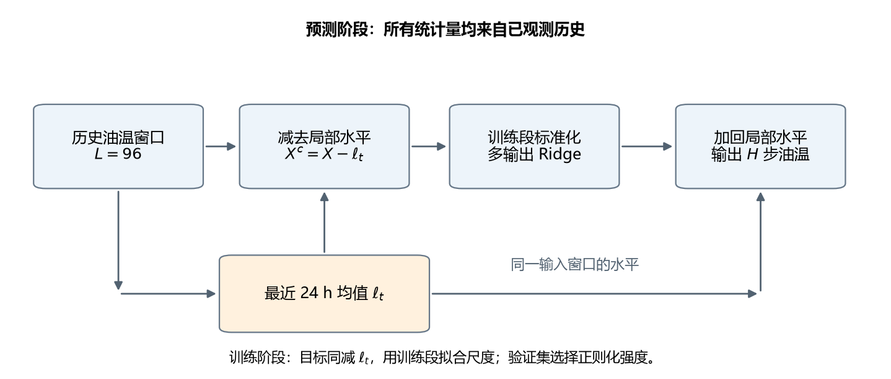
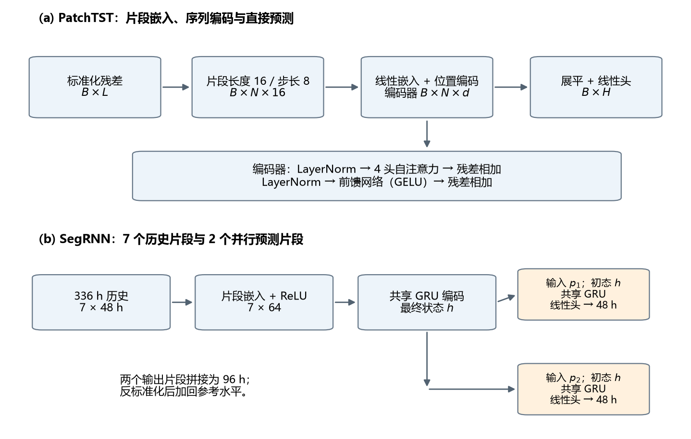

# 越复杂越好？——ETTh1 油温单变量长序列预测


一个围绕 ETTh1 小时级油温（Oil Temperature, OT）预测的可复现实验仓库。项目只使用历史 OT，在官方 12/4/4 划分下比较统计基线、线性模型、多层感知机、循环网络、DLinear、PatchTST 与 SegRNN，回答一个具体问题：**在这个任务上，增加模型复杂度是否值得？**

核心结论：局部水平处理比结构复杂度更直接。Anchored Ridge 以最近 96 h OT 为输入、最近 24 h 均值为参考，用多输出 Ridge 预测未来偏移，96 h 测试 MAE 为 **1.632 ℃**。负载通道、336 h 历史、自注意力替换和非线性结构都没有带来稳定的单模型增益；三模型集成可以降低方差，但需要三个网络和三次训练。

## 目录

- [项目简介](#项目简介)
- [模型示意图](#模型示意图)
- [主要发现](#主要发现)
- [项目结构](#项目结构)
- [环境与安装](#环境与安装)
- [数据](#数据)
- [快速开始](#快速开始)
- [复现实验](#复现实验)
- [结果摘要](#结果摘要)
- [论文与图表](#论文与图表)
- [可复现性与已知限制](#可复现性与已知限制)
- [贡献](#贡献)
- [引用](#引用)
- [许可证](#许可证)
- [参考与致谢](#参考与致谢)

## 项目简介

电力变压器油温受负荷、环境和运行状态影响。根据历史油温估计未来油温，是温度预警、负载安排和设备健康评估的基础。ETTh1 是 Informer 论文发布的电力变压器小时级数据集，包含 6 个负荷通道和 1 个油温通道；本仓库使用 Informer 官方的 **S 模式**：单变量输入、单变量输出，只预测 OT。

项目关注三个问题：

1. **What**：在固定时间划分下，历史 OT 能支持多远的未来预测？不同模型结构的误差差异有多大？
2. **Why**：现有 Transformer/线性模型文献对 ETT 的结论并不一致；需要把水平漂移、输入变量和历史长度分开检验。
3. **How**：给出一个可复现、可部署的单模型方案，并用统计基线、线性模型、神经模型和多组消融验证它。

## 模型示意图



*Anchored Ridge：输入最近 96 h OT，减去最近 24 h 均值，用多输出 Ridge 预测未来 96 h 偏移，再加回局部水平。*

### 对照模型结构



*PatchTST 将序列切成片段后做 Transformer 编码；SegRNN 用片段级 GRU 编码历史，并并行解码两个未来片段。MLP、GRU、LSTM 与 DLinear 的细节见论文附录。*

## 主要发现

- **水平漂移是主要瓶颈。** 普通 Ridge 直接拟合绝对油温，测试 MAE 1.670 ℃，但平均偏差 **+0.780 ℃**，且偏差随预测步从 +0.317 ℃ 增至 +1.105 ℃。用测试集逐步平均误差做 oracle 去偏后，MSE 从 5.107 降至 4.400，说明形状并不差，问题主要是水平。
- **局部水平锚定有效。** 用最近 24 h 均值做参考，Anchored Ridge 的偏差降至 **+0.105 ℃**，MSE/MAE 为 **4.613/1.632 ℃**；相对 24 h 均值基线的 MAE 降低 10.3%，配对 bootstrap 区间不跨零。
- **线性模型已经很强。** 锚定 DLinear 的 MAE 为 1.635 ℃，与 Anchored Ridge 基本持平；这说明水平信息可以由不同结构捕捉。
- **非线性没有稳定增益。** 锚定后的 MLP、GRU、LSTM、PatchTST 单模型 MAE 分别为 1.663、1.671、1.759、1.644 ℃，均未低于 Anchored Ridge 的 1.632 ℃；16 维 PatchTST 的三模型集成达到 1.600 ℃，但代价是三个网络。
- **增加输入或历史不一定有用。** 七通道负载输入的 MAE 为 1.795 ℃，高于单变量对照的 1.633 ℃；336 h 历史对 Ridge 和 PatchTST 都没有提供稳定的误差降低证据；自注意力替换为片段混合 MLP 的差异也不显著。
- **长预测不是简单外推。** 96/192/336/720 h 的 MAE 分别为 1.632/1.914/2.129/2.116 ℃；不同预测长度使用不同的有效起点集合，720 h 的 MAE 点估计低于 336 h 不代表远期更容易，需结合同起点比较和逐步误差曲线阅读。

## 项目结构

```text
ETTh1/
├── ETTh1.csv                     # 原始数据，只读
├── DATASET.md                    # 数据来源、字段、统计与评测协议
├── DATA_QUALITY.md               # 缺失/冻结/停机等质量检查
├── EDA.md                        # 探索性分析与预测难度
├── SPLITS.md                     # 官方 12/4/4 划分与窗口索引
├── BASELINES_ROUND1.md           # 统计基线
├── RIDGE_S96_H96.md              # 普通 Ridge
├── RIDGE_LEVEL_S96_H96.md        # 局部水平锚定 Ridge（最终方案）
├── MLP_S96_H96.md
├── GRU_S96_H96.md
├── LSTM_S96_H96.md
├── PATCHTST_S96_H96.md
├── DLINEAR_S96_H96.md
├── RIDGE_MS_S96_H96.md           # 多变量输入、单变量输出
├── S96_H192.md / S96_H336.md / S96_H720.md
├── PATCHTST_L336_H96.md          # 长历史 PatchTST
├── SEGRNN_L336_H96.md
├── PATCHTST_NOATTN_S96_H96.md    # 注意力消融
├── scripts/                      # 全部可执行实验脚本
├── outputs/                      # 指标、图表、日志与划分文件
├── paper/                        # 论文源文件、PDF、图与参考文献
├── references.bib
└── AGENTS.md                     # 环境与项目约定
```

## 环境与安装

推荐使用 Python 3.12 环境；本仓库在 conda `ml` 环境中验证。以下命令假设 `python` 指向该环境，若未加入 `PATH`，请替换为对应的解释器。

```powershell
python -c "import pandas, numpy, torch; print(pandas.__version__, numpy.__version__, torch.__version__, torch.cuda.is_available())"
```

实测环境：

| 组件 | 版本 / 配置 |
|---|---|
| Python | 3.12.15 |
| numpy / pandas / scipy | 2.5.4 / 3.1.0 / 1.18.1 |
| scikit-learn / matplotlib / seaborn | 1.9.1 / 3.11.2 / 0.13.2 |
| PyTorch / torchvision | 2.14.1+cu130 / 0.29.1+cu130 |
| CUDA | 13.0 |
| GPU | NVIDIA GPU，24 GB |
| LaTeX | TeX Live 2025，XeLaTeX + BibTeX |

依赖已安装在 `ml` 环境中。若需要重建环境，可使用该环境的 pip：

```powershell
python -m pip install numpy pandas scipy scikit-learn matplotlib seaborn torch lightgbm xgboost tqdm
```

## 数据

| 项 | 值 |
|---|---|
| 文件 | `ETTh1.csv` |
| 行数 | 17,420（不含表头） |
| 时间范围 | 2016-07-01 00:00 — 2018-06-26 19:00 |
| 采样间隔 | 1 h |
| 列 | `date, HUFL, HULL, MUFL, MULL, LUFL, LULL, OT` |
| 缺失 / 重复 | 无 NaN，无重复时间戳 |
| SHA256 | `f18de3ad269cef59bb07b5438d79bb3042d3be49bdeecf01c1cd6d29695ee066` |

官方 12/4/4 划分按 **30 天/月** 计算，而不是日历月：

| 数据段 | 行索引 | 行数 | 日期范围 |
|---|---|---:|---|
| 训练 | `[0, 8640)` | 8,640 | 2016-07-01 — 2017-06-25 |
| 验证 | `[8640, 11520)` | 2,880 | 2017-06-26 — 2017-10-23 |
| 测试 | `[11520, 14400)` | 2,880 | 2017-10-24 — 2018-02-20 |
| 未使用 | `[14400, 17420)` | 3,020 | 2018-02-21 — 2018-06-26 |

使用数据前请先阅读 `DATA_QUALITY.md`。重要伪影包括：每月 31 日整日冻结、2016-12 负荷零值停机、LUFL/LULL 141 h 卡死。这些常量/0 不应被当成真实观测；当前实验保留原始数值，因此结果反映含伪影数据上的预测误差。

## 快速开始

在仓库根目录运行（`python` 指向上文的 Python 3.12 环境）：

```powershell
# 1. 数据质量、EDA、官方划分
python scripts\data_quality_check.py
python scripts\eda_etth1.py
python scripts\make_splits.py

# 2. 统计基线与普通 Ridge
python scripts\baselines_round1.py
python scripts\ridge_s96_h96.py

# 3. 最终方案：局部水平锚定 Ridge
python scripts\ridge_level_s96_h96.py
```

最终方案的产物在 `outputs/ridge_level/`，核心指标在 `outputs/ridge_level/test_metrics.csv` 与 `outputs/ridge_level/summary.json`，实验说明见 `RIDGE_LEVEL_S96_H96.md`。

神经模型训练需要 GPU，默认使用三个随机种子，耗时明显高于 Ridge。建议先跑通上面的线性流程，再按需运行单个模型：

```powershell
python scripts\mlp_s96_h96.py
python scripts\gru_s96_h96.py
python scripts\lstm_s96_h96.py
python scripts\patchtst_s96_h96.py
```

## 复现实验

| 实验 | 脚本 | 输出目录 |
|---|---|---|
| 数据质量检查 | `scripts/data_quality_check.py` | `outputs/data_quality/` |
| 探索性分析 | `scripts/eda_etth1.py` | `outputs/eda/` |
| 官方划分与窗口索引 | `scripts/make_splits.py` | `outputs/splits/` |
| 五个统计基线 | `scripts/baselines_round1.py` | `outputs/baselines/` |
| 普通 Ridge | `scripts/ridge_s96_h96.py` | `outputs/ridge/` |
| Anchored Ridge | `scripts/ridge_level_s96_h96.py` | `outputs/ridge_level/` |
| MLP / GRU / LSTM | `scripts/mlp_s96_h96.py` 等 | `outputs/mlp/` 等 |
| PatchTST | `scripts/patchtst_s96_h96.py` | `outputs/patchtst/` |
| DLinear | `scripts/dlinear_s96_h96.py` | `outputs/dlinear/` |
| MS 负载输入 | `scripts/ridge_ms_s96_h96.py` | `outputs/ridge_ms/` |
| H=192 / 336 / 720 | `scripts/forecast_s96_h192.py` 等 | `outputs/h192/` 等 |
| 长历史 PatchTST | `scripts/patchtst_l336_h96.py` | `outputs/patchtst_l336/` |
| SegRNN | `scripts/segrnn_l336_h96.py` | `outputs/segrnn/` |
| 注意力消融 | `scripts/patchtst_noattn_s96_h96.py` | `outputs/attn_ablation/` |
| 论文图与表 | `scripts/paper_figures.py` | `paper/figures/`、`paper/tables/` |

所有脚本都从 `ETTh1.csv` 读取原始数据，不覆盖原始 CSV。标准化统计量只在训练段拟合；验证段用于模型/超参数选择，测试段只用于最终评价。细节见各实验报告与 `AGENTS.md`。

## 结果摘要

96 h 输入、96 h 输出的主结果（原始 ℃，神经模型与 DLinear 为三种子均值）：

| 模型 | MSE (℃²) | MAE (℃) | 平均偏差 (℃) | 说明 |
|---|---:|---:|---:|---|
| 24 h 均值（B2a） | 5.454 | 1.820 | +0.144 | 局部水平基线 |
| 普通 Ridge | 5.107 | 1.670 | +0.780 | 直接拟合绝对油温 |
| **Anchored Ridge** | **4.613** | **1.632** | **+0.105** | 最终单模型 |
| DLinear（锚定） | 4.616 | 1.635 | +0.093 | 趋势分解 |
| MLP（锚定） | 4.680 | 1.663 | −0.034 | 两层 128 单元 |
| GRU（锚定） | 4.776 | 1.671 | −0.030 | 单层 64 维 |
| LSTM（锚定） | 5.077 | 1.759 | −0.202 | 单层 64 维 |
| PatchTST 16 维（锚定） | 4.842 | 1.644 | +0.301 | 三种子均值 |
| PatchTST 16 维集成 | 4.632 | **1.600** | — | 三模型集成 |

跨预测长度（96 h 历史，Anchored Ridge）：

| 预测长度 | MSE (℃²) | MAE (℃) | 相对 24 h 均值 MAE 改善 |
|---:|---:|---:|---:|
| 96 h | 4.613 | 1.632 | 10.37% |
| 192 h | 6.178 | 1.914 | 7.23% |
| 336 h | 7.310 | 2.129 | 6.43% |
| 720 h | 7.092 | 2.116 | 11.65% |

注意：不同预测长度使用不同的有效测试起点集合（2,785 → 2,161），表中的跨行差异同时包含目标长度和起点集合变化；同起点比较与逐步误差分析见 `S96_H192.md`、`S96_H336.md`、`S96_H720.md`。

更多数值、逐窗口 bootstrap 区间、分段误差和图表见各实验目录下的报告与 `outputs/`。

## 论文与图表

论文阅读稿为 `paper/main.pdf`（当前 20 页），源文件为 `paper/main.tex`，参考文献为 `paper/references.bib`。论文结构、写作依据和图表说明见 `paper/README.md`。

## 可复现性与已知限制

- 固定官方 12/4/4 划分；验证/测试输入可以跨越前一段边界，但预测目标保持在所属数据段内。
- 标准化、特征统计和模型选择都只使用训练/验证段；测试标签不参与预测校正。
- 神经模型使用随机种子 0、1、2；报告三种子均值、标准差与预测集成。
- 配对比较沿预测起点抽取连续 96 个窗口组成的块，进行 2,000 次 block bootstrap，报告 95% 区间。
- 当前测试段集中在晚秋至冬季，不能代表全年；数据包含冻结日、停机段和采集伪影，需在全年滚动评价和伪影敏感性分析中继续检查。
- 336/720 h 的模型比较主要覆盖 Anchored Ridge 与统计基线；长历史 PatchTST 实验同时改变了输入长度和预测头规模，不能把所有差异都归因于历史长度。
- 本仓库没有生产级推理 API；最终预测器的公式与计算流程见 `RIDGE_LEVEL_S96_H96.md` 和论文第 5 节、第 7.2 节。

## 贡献

欢迎通过 issue 或 pull request 提交可复现的改进。贡献时请：

1. 说明改动对应的实验问题、脚本和输出目录；
2. 保持原始 `ETTh1.csv` 只读，不覆盖或就地清洗；
3. 标准化只在训练段拟合，测试段不参与调参；
4. 更新对应报告，并附上运行命令、随机种子和关键指标；
5. 不要提交 `__pycache__/`、`*.pyc`、临时文件、密钥或未说明的 checkpoint。

## 引用

如果使用本仓库的数据划分或实验设置，请引用 ETDataset/Informer：

```bibtex
@inproceedings{zhou2021informer,
  title     = {Informer: Beyond Efficient Transformer for Long Sequence Time-Series Forecasting},
  author    = {Zhou, Haoyi and Zhang, Shanghang and Peng, Jieqi and Zhang, Shuai
               and Li, Jianxin and Xiong, Hui and Zhang, Wancai},
  booktitle = {Proceedings of the AAAI Conference on Artificial Intelligence},
  volume    = {35},
  number    = {12},
  pages     = {11106--11115},
  year      = {2021},
  doi       = {10.1609/aaai.v35i12.17325}
}
```

## 许可证

本仓库目前未附 `LICENSE` 文件，默认保留所有权利。若需复用代码或实验设置，请先联系作者确认。`ETTh1.csv` 的版权与使用条款归 ETDataset/Informer 作者所有。

## 参考与致谢

- [ETDataset](https://github.com/zhouhaoyi/ETDataset)：ETTh1 数据与说明。
- [Informer](https://github.com/zhouhaoyi/Informer2020)：S/MS 任务定义与官方实现。
- [Time-Series-Library](https://github.com/thuml/Time-Series-Library)：ETT 标准划分与评测协议。
- [LTSF-Linear / DLinear](https://github.com/cure-lab/LTSF-Linear)：线性预测与趋势分解。
- [PatchTST](https://github.com/yuqinie98/PatchTST)：片段 Transformer。
- [SegRNN](https://github.com/lss-1138/SegRNN)：片段循环预测。
- [RevIN](https://github.com/ts-kim/RevIN)：可逆实例归一化。

项目约定、环境细节和提交规则见 `AGENTS.md`。
